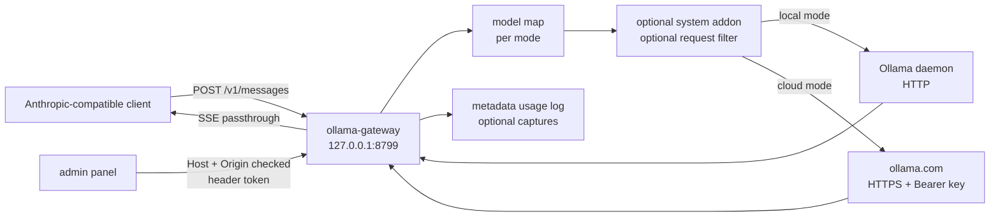

# Architecture

The gateway is a single Node.js process with one HTTP listener and one upstream
transport. It is deliberately small: routing, model mapping and policy live in
one file so the behavior is auditable end to end.

## Request flow

## Request lifecycle

1. `POST /v1/messages` is read with a 32 MB limit.
2. JSON is parsed. If parsing fails, the body is forwarded unchanged.
3. `model` is resolved through the active mode's map, then its fallback. If
   neither exists, the original name is kept so the upstream can return a clear
   error.
4. Optional title fix, system addon and request filter run. Each is off or empty
   by default.
5. The request is forwarded to the active upstream. Client `Authorization` and
   `x-api-key` headers are removed. Cloud mode adds the configured Ollama key.
6. The response is piped back without rewriting. The gateway buffers a bounded
   copy only to read usage numbers.
7. On client disconnect, the upstream request is destroyed.

`count_tokens` is answered locally with an estimate unless the estimate is
disabled, in which case it is forwarded. `GET /v1/models` is forwarded.

## Configuration

Configuration is a single JSON object with shared policy (`systemAddon`,
`blockRules`, `titleFix`, `countTokens`, `logging`, `admin`) and two upstream
sections (`local`, `cloud`). Each upstream section has its own model map and
fallback, so switching modes does not require editing both.

Resolution order: `--config`, `PROXY_CFG`, `proxy-config.json` next to the
script, user config directory. Runtime data goes next to the config file unless
`--data-dir` or `PROXY_DATA_DIR` overrides it.

Old single-mode configuration files are migrated in memory: top-level
`ollamaHost` becomes `local`, top-level `apiKey` becomes `cloud`.

## Admin API

All admin routes live under `/admin/api` and require `x-admin-token` when the
panel password is set.

| Method | Path | Purpose |
| --- | --- | --- |
| GET | `/admin/api/config` | Current config, secrets masked |
| POST | `/admin/api/config` | Merge and save a partial config |
| GET | `/admin/api/config/export` | Portable config without secrets |
| POST | `/admin/api/config/import` | Replace the config from a file |
| POST | `/admin/api/config/reset` | Restore defaults, keep or rotate secrets |
| GET | `/admin/api/status` | Version, uptime, upstream health, counters |
| GET | `/admin/api/models` | Upstream model list from `/api/tags`, 30 s cache |
| POST | `/admin/api/test-message` | One round trip through the active map |
| GET | `/admin/api/log` | usage-log tail |
| POST | `/admin/api/log/clear` | Empty the usage log |
| GET | `/admin/api/captures` | Capture file list and size |
| POST | `/admin/api/captures/clear` | Delete the capture files |
| POST | `/admin/api/upstream/check` | Health probe used by the panel |

Model discovery is advisory. A target the upstream does not report is
highlighted in the panel but never blocked, because a map may point at a model
that is still downloading.

## Security boundaries

- The listener binds `127.0.0.1`.
- Admin routes check `Host` and `Origin` against the actual listening port,
  which blocks DNS rebinding and cross-site requests.
- Configuration writes require `Content-Type: application/json`.
- The panel token is accepted only in `x-admin-token`, compared over SHA-256
  hashes with `timingSafeEqual`.
- Secrets are never returned by the admin API. The panel only learns whether
  they are set.
- The panel is served with `script-src 'self'`; its script is an external file.
- Client credentials never reach the upstream.

## Logging and capture

- Usage log: metadata only by default, rotated at 50 MB.
- Prompt heads: opt-in, 300 characters.
- Capture: opt-in, full request and response bodies in plain text.
- Probe log: opt-in diagnostic, off by default.

## Failure modes

- Port in use: clear startup error and non-zero exit code.
- Upstream unreachable: 502 with the upstream error message.
- Upstream timeout: socket destroyed, 502 when headers were not sent.
- Malformed JSON request: forwarded verbatim.
- Oversized body: 413, connection closed.
- Invalid configuration: sanitized in memory, warnings shown in the panel.

## Extension points

The roadmap adds provider adapters and routing rules. The seams are intentionally
narrow:

- `upstreamRequest` is the only transport.
- `resolveModelFor` is the only model-name policy.
- `handleRequest` is the only route table.
- `createServer` accepts an explicit config and data directory, which is what
  the integration tests use.

New adapters should preserve the wire-format contract and add tests against a
fake upstream before touching the core.
